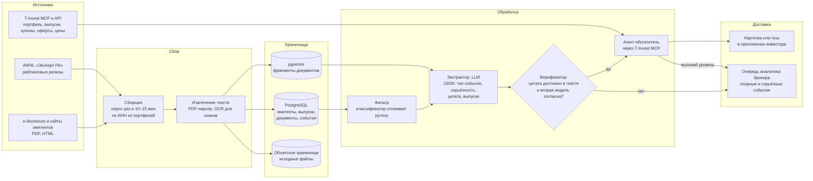

# Монитор раскрытий эмитентов облигаций — схема MVP

Команда AI Columbus, «Инвест. Премаркет», этап SIGNAL IN. Материал к задаче 11: схема архитектуры, пример результата и план первого эксперимента. Всё ниже — замысел, а не готовый продукт.

## Идея в одном абзаце

Частный инвестор держит корпоративные облигации, чаще всего высокодоходные. Эмитент заранее публикует тревожные документы: перенос выплаты, смену аудитора, нарушение ковенанта, рост долга в отчётности. Но инвестор узнаёт о проблеме по падению цены. Сервис читает новые раскрытия по бумагам из портфеля клиента и присылает короткую карточку: что случилось, почему это важно, дословная цитата и ссылка на документ. Советов «продавайте» сервис не даёт, только факты и их смысл.

## Архитектура MVP

Компоненты связаны очередью задач: новый документ → фильтр → экстрактор → верификатор → обогащение → доставка. Целевая задержка — до часа после публикации документа.

## Почему два слоя проверки

Главный риск такого сервиса — модель «увидела» проблему, которой нет, и клиент продал здоровую бумагу с убытком. Поэтому каждое событие проходит две проверки, прежде чем попасть к клиенту:

1. **Код** ищет цитату в исходном тексте посимвольно, после нормализации пробелов и переносов. Нет цитаты — нет события.
2. **Вторая модель** с чистого контекста получает только цитату и документ и отвечает, подтверждает ли цитата трактовку экстрактора. При расхождении событие уходит аналитику, а не клиенту.

Этот приём мы уже применяем в своём конвейере разбора документации закупок: там модель возвращает требования к участнику с дословными цитатами, и ошибки отлавливаются именно на проверке цитаты.

## Что получает инвестор

Условный пример с вымышленным эмитентом, чтобы показать формат:

| Поле | Содержание |
|---|---|
| Бумага | ООО «Пример-Лизинг», БО-03 (у вас 40 шт.) |
| Уровень | Высокий |
| Что случилось | Эмитент сообщил, что не выплатил купон в срок и обещает выплату в течение 10 рабочих дней |
| Почему важно | Это технический дефолт. Если выплаты не будет за 10 рабочих дней, он перейдёт в дефолт, и держатели смогут требовать досрочного погашения |
| Цитата | «…обязательство по выплате купонного дохода не исполнено в срок…» |
| Источник | Ссылка на сообщение о существенном факте |
| Ближайшее по выпуску | Оферта через 47 дней, погашение через 1 год 8 месяцев |

Карточка не говорит, что делать. Решение остаётся за инвестором: держать, продать или участвовать в оферте.

## Первый эксперимент

| Что | Как |
|---|---|
| Гипотеза | По раскрытиям эмитента рост кредитного риска виден раньше, чем цена облигации падает на 10% и больше |
| Данные | Выпуски с дефолтом или реструктуризацией в 2024–2025 годах и сопоставимая группа без дефолта; все раскрытия за 12 месяцев до события |
| С чем сравниваем | Поиск по словарю ключевых слов плюс сигнал по понижению рейтинга |
| Основная метрика | Полнота: доля дефолтных выпусков, по которым сигнал высокого уровня поднят заранее |
| Целевые значения | Полнота от 70%, медианное опережение от 14 дней, не больше одного ложного сигнала на выпуск в квартал, 100% цитат проходят проверку на дословность |

Пороги — наши целевые ориентиры, а не результат измерений. Их уточним после ретроспективы.

## Что проверяем до основной разработки

1. **Опережение.** Ретроспектива на 20–30 прошедших дефолтах: есть ли сигнал в документах раньше падения цены.
2. **Ложные тревоги.** Доля ложных сигналов на контрольной группе.
3. **Регуляторика.** Формат «только факты и цитаты» согласуем с юристами, чтобы сигнал не сочли индивидуальной инвестрекомендацией.
4. **Данные.** Пробная выгрузка раскрытий за месяц и условия автоматического сбора.
5. **Спрос.** Показ прототипа небольшой группе инвесторов и замер открытий карточек.

## Откуда цифры

По данным Банка России, в 2025 году дефолт по облигациям допустили 36 эмитентов. Сделки с проблемными бумагами совершили 163 тыс. физлиц против 48 тыс. годом ранее: [Интерфакс](https://www.interfax.ru/business/1077674).
